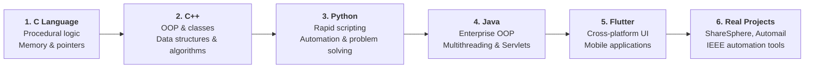

# 🚀 My Coding Journey

[](https://github.com/devantaris/my-coding-journey)
[](https://github.com/devantaris/my-coding-journey)
[](https://github.com/devantaris/my-coding-journey)

> *"The journey of a thousand miles begins with a single line of code."*

Welcome to **My Coding Journey** — a structured, topic-by-topic chronicle documenting my complete progression as a software developer. This repository traces my trajectory through five major programming paradigms: from procedural thinking in **C**, object-oriented systems & data structures in **C++**, versatile automation & algorithms in **Python**, enterprise application architecture & servlets in **Java**, to cross-platform mobile app development in **Flutter**, alongside production-ready projects.

---

## 🗺️ The Developer Evolution Roadmap



---

## 📂 Repository Architecture

```text
my-coding-journey/
├── 📁 C/
│   ├── 01_Basics_and_Loops/            # Procedural basics, while loops, mathematical calculations
│   └── 02_Arrays_and_Pointers/         # Array transformations, unique element filters
│
├── 📁 Cpp/
│   ├── 01_Basics_and_Math/             # Arithmetic, base conversions, digit manipulation
│   ├── 02_Conditionals_and_Control_Flow/# Logical branching, leap year checks, comparisons
│   ├── 03_Functions_and_Overloading/   # Function overloading, parameter passing, return values
│   ├── 04_Classes_and_OOP/             # Encapsulation, constructors, destructors, friend functions
│   ├── 05_Inheritance_and_Polymorphism/# Single, multilevel, multiple, hierarchical, virtual functions
│   ├── 06_Data_Structures/
│   │   ├── Linked_Lists/               # Singly & doubly linked lists (insert, delete, traverse)
│   │   └── Stacks_and_Queues/          # Stack, queue, circular queue, double-ended queue (deque)
│   ├── 07_Algorithms/
│   │   ├── Searching/                  # Linear search, binary search
│   │   └── Sorting/                    # Bubble, insertion, selection, merge sort
│   └── 08_Templates/                   # Generic programming and function templates
│
├── 📁 Python/
│   ├── 01_Basics_and_Syntax/           # Variables, string slicing, formatting, input/output
│   ├── 02_Conditionals_and_Logic/      # Decision structures, number categorization
│   ├── 03_Loops_and_Patterns/          # For/while loops, primes, Armstrong, Fibonacci, GCD/HCF
│   ├── 04_Functions_and_Modules/       # Modular functions, math & regex libraries, currency converter
│   ├── 05_Data_Structures/             # List comprehensions, nested lists, custom sorting
│   ├── 06_OOP_and_Classes/             # Classes, __init__, inheritance, getters/setters, properties
│   ├── 07_File_Handling_and_Exceptions/# File read/write, stream manipulation, try/except/finally
│   └── 08_Problem_Solving_and_Academic/# CodeChef challenges, LeetCode, university semester projects
│
├── 📁 Java/
│   ├── 01_Basics_and_Math/             # Primitive types, geometry calculations, simple interest
│   ├── 02_Conditionals_and_Patterns/   # Switch-case, nested loops, star/pyramid patterns
│   ├── 03_Strings_and_Formatting/      # String immutability, StringBuffer manipulation
│   ├── 04_OOP_and_Inheritance/         # Class design, constructors, super/this keywords, interfaces
│   ├── 05_Exception_Handling_and_IO/   # Checked/unchecked exceptions, custom handlers, file copy
│   ├── 06_GUI_and_Multithreading/      # Java AWT/Swing frames, thread lifecycle, Pomodoro timer
│   ├── 07_Packages_and_Modules/        # User-defined packages and namespace modularity
│   ├── 08_Servlets_and_WebApps/        # Dynamic web applications, HTTP Servlets, request handling
│   ├── 09_NetBeans_Projects/           # NetBeans IDE desktop application suites
│   └── 10_Notes_and_SQL/               # Relational SQL schemas, lab conceptual notes
│
├── 📁 Flutter/
│   ├── flutter_application_1/          # Initial Flutter exploration and widget sandbox
│   ├── flutter_application_2/          # UI layouts, container styling, responsive experimentation
│   ├── login_app/                      # Interactive user authentication and form validation UI
│   └── ott_app/                        # OTT streaming service media dashboard and card layouts
│
└── 📁 Projects/
    ├── 01_Automail_Utility/            # Python-based multi-threaded batch email dispatcher
    ├── 02_IEEE_Sponsorship_Tools/      # Corporate outreach engine and sponsor tracking pipelines
    ├── 03_ShareSphere_Splitwise/       # Desktop expense tracker & bill splitting application (Tkinter)
    └── 04_SehatSure/                   # Healthcare utility scripts and predictive assessment tools
```

---

## 🛠️ Tech Stack & Language Overview

| Language / Framework | Key Paradigm | Primary Focus Areas |
| :--- | :--- | :--- |
| **C** | Procedural / Low-Level | Memory allocation, pointers, procedural control flow |
| **C++** | OOP & Systems | Encapsulation, inheritance, polymorphism, data structures (LinkedList, Queue, Stack, Sorts) |
| **Python** | Multi-paradigm / Scripting | Automation, string parsing, regex, file I/O, algorithmic problem solving |
| **Java** | Object-Oriented / Enterprise | Core OOP, multithreading, exception hierarchies, Java Servlets & Web Applications |
| **Flutter & Dart** | Declarative UI / Mobile | Cross-platform stateful/stateless widgets, auth flows, streaming UI layouts |

---

## 🌟 Featured Highlights

### 1. 📧 AutoMail Dispatcher
* **Stack**: Python (`smtplib`, `ssl`, `email.mime`, `threading`)
* **Features**: Automated batch dispatching, attachment encoding (Base64 MIME), TLS encryption, configurable delay intervals to respect SMTP rate limits.

### 2. 💸 ShareSphere (Splitwise Clone)
* **Stack**: Python, Tkinter GUI
* **Features**: Multi-user bill splitting, shared ledger computation, category-based expense management, intuitive graphical user interface.

### 3. 🎬 OTT & Streaming Mobile UI
* **Stack**: Flutter / Dart
* **Features**: Media catalog layout, dynamic card carousels, responsive mobile interface across iOS & Android.

### 4. ☕ Enterprise Java Servlets & Attendance System
* **Stack**: Java Servlets, JSP, MySQL, JDBC
* **Features**: Relational database persistence, dynamic session management, HTTP request-response pipeline.

---

## 📈 Learning Milestones

- [x] **Procedural Foundation**: Mastering manual flow control and memory structures in C.
- [x] **Object-Oriented Mastery**: Implementing complex class hierarchies, virtual tables, and friend functions in C++.
- [x] **Data Structures & Algorithms**: Implementing Linked Lists, Circular Queues, Stacks, Binary Search, and Merge Sort from scratch.
- [x] **Scripting & Automation**: Building utilities for bulk automation, file manipulation, and competitive programming in Python.
- [x] **Enterprise Architecture**: Deploying Java Servlets, multi-threaded GUI systems, and database connectors.
- [x] **Mobile Engineering**: Delivering polished, cross-platform mobile user interfaces with Flutter.

---

*Authored by [Devansh Kumar](https://github.com/devantaris) as a living record of continuous engineering growth.*
