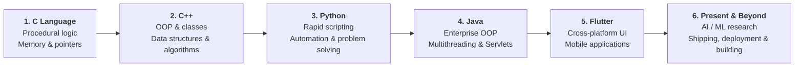

# 🚀 My Coding Journey

> *When I used to code every single word with my own hands — long before "vibe coding", AI assistants, or having any idea about modern development, frameworks, and architecture.*

[](https://github.com/devantaris/my-coding-journey)
[](https://github.com/devantaris/my-coding-journey)

---

## 📖 About This Archive

This repository serves as a personal time capsule documenting my entire progression through computer science and programming. Every file here represents a phase of learning how computers think — starting from raw syntax, manual memory logic, and writing programs character-by-character from scratch, moving into object-oriented principles, algorithmic problem solving, web backends, and eventually mobile development.

The sole purpose of this repo is to showcase that raw, hands-on journey.

---

## 🗺️ The Progression



---

## 📂 Repository Structure

```text
my-coding-journey/
├── 📁 C/
│   ├── 01_Basics_and_Loops/            # Procedural basics, while loops, mathematical calculations
│   └── 02_Arrays_and_Pointers/         # Array transformations, unique element filters
│
├── 📁 Cpp/
│   ├── 01_Basics_and_Math/             # Arithmetic, base conversions, digit manipulation
│   ├── 02_Conditionals_and_Control_Flow/# Logical branching, leap year checks, comparisons
│   ├── 03_Functions_and_Overloading/   # Function overloading, parameter passing, return values
│   ├── 04_Classes_and_OOP/             # Encapsulation, constructors, destructors, friend functions
│   ├── 05_Inheritance_and_Polymorphism/# Single, multilevel, multiple, hierarchical, virtual functions
│   ├── 06_Data_Structures/
│   │   ├── Linked_Lists/               # Singly & doubly linked lists (insert, delete, traverse)
│   │   └── Stacks_and_Queues/          # Stack, queue, circular queue, double-ended queue (deque)
│   ├── 07_Algorithms/
│   │   ├── Searching/                  # Linear search, binary search
│   │   └── Sorting/                    # Bubble, insertion, selection, merge sort
│   └── 08_Templates/                   # Generic programming and function templates
│
├── 📁 Python/
│   ├── 01_Basics_and_Syntax/           # Variables, string slicing, formatting, input/output
│   ├── 02_Conditionals_and_Logic/      # Decision structures, number categorization
│   ├── 03_Loops_and_Patterns/          # For/while loops, primes, Armstrong, Fibonacci, GCD/HCF
│   ├── 04_Functions_and_Modules/       # Modular functions, math & regex libraries, currency converter
│   ├── 05_Data_Structures/             # List comprehensions, nested lists, custom sorting
│   ├── 06_OOP_and_Classes/             # Classes, __init__, inheritance, getters/setters, properties
│   ├── 07_File_Handling_and_Exceptions/# File read/write, stream manipulation, try/except/finally
│   └── 08_Problem_Solving_and_Academic/# CodeChef challenges, LeetCode, university semester projects
│
├── 📁 Java/
│   ├── 01_Basics_and_Math/             # Primitive types, geometry calculations, simple interest
│   ├── 02_Conditionals_and_Patterns/   # Switch-case, nested loops, star/pyramid patterns
│   ├── 03_Strings_and_Formatting/      # String immutability, StringBuffer manipulation
│   ├── 04_OOP_and_Inheritance/         # Class design, constructors, super/this keywords, interfaces
│   ├── 05_Exception_Handling_and_IO/   # Checked/unchecked exceptions, custom handlers, file copy
│   ├── 06_GUI_and_Multithreading/      # Java AWT/Swing frames, thread lifecycle, Pomodoro timer
│   ├── 07_Packages_and_Modules/        # User-defined packages and namespace modularity
│   ├── 08_Servlets_and_WebApps/        # Dynamic web applications, HTTP Servlets, request handling
│   ├── 09_NetBeans_Projects/           # NetBeans IDE desktop application suites
│   └── 10_Notes_and_SQL/               # Relational SQL schemas, lab conceptual notes
│
├── 📁 Flutter/
│   ├── flutter_application_1/          # Initial Flutter exploration and widget sandbox
│   ├── flutter_application_2/          # UI layouts, container styling, responsive experimentation
│   ├── login_app/                      # Interactive user authentication and form validation UI
│   └── ott_app/                        # OTT streaming service media dashboard and card layouts
│
└── 📁 Projects/
    ├── 01_Automail_Utility/            # Python-based multi-threaded batch email dispatcher
    ├── 02_IEEE_Sponsorship_Tools/      # Corporate outreach engine and sponsor tracking pipelines
    ├── 03_ShareSphere_Splitwise/       # Desktop expense tracker & bill splitting application (Tkinter)
    └── 04_SehatSure/                   # Healthcare utility scripts and predictive assessment tools
```

---

## 🛠️ Phases & Paradigms

| Phase | Paradigm | Focus |
| :--- | :--- | :--- |
| **C** | Procedural / Low-Level | Understanding basic execution flow, loops, memory, and pointers |
| **C++** | OOP & Systems | Classes, inheritance, polymorphism, and implementing fundamental data structures from scratch |
| **Python** | Multi-paradigm / Scripting | Writing automation scripts, string parsing, regex, file I/O, and problem solving |
| **Java** | Object-Oriented / Enterprise | OOP rigor, multithreading, exception handling, and early web backends (Servlets) |
| **Flutter & Dart** | Declarative UI / Mobile | Exploring cross-platform UI development, widgets, and mobile apps |
| **Present & Beyond** | Modern Engineering | AI / ML research, production shipping, deployments, and full-stack building |

---

## 📈 Learning Milestones

- [x] **Procedural Foundations (C)**: Typing every single character by hand, understanding loops, conditionals, and memory without abstractions.
- [x] **Object-Oriented Systems (C++)**: Hand-crafting class hierarchies, virtual tables, friend functions, and low-level data structures (Linked Lists, Queues, Stacks, Sorting algorithms).
- [x] **Automation & Scripting (Python)**: Solving competitive programming challenges, text processing, and building utility scripts.
- [x] **Enterprise Rigor (Java)**: Mastering OOP principles, multi-threaded GUI applications, and dynamic Java Servlets.
- [x] **Cross-Platform Mobile (Flutter)**: Building structured mobile applications, authentication flows, and streaming UI layouts.
- [x] **Present & Beyond**: Transitioning into AI/ML research, shipping products, and continuous deployment.

---

*Authored by [Devansh Kumar](https://github.com/devantaris) as a personal coding timeline.*
